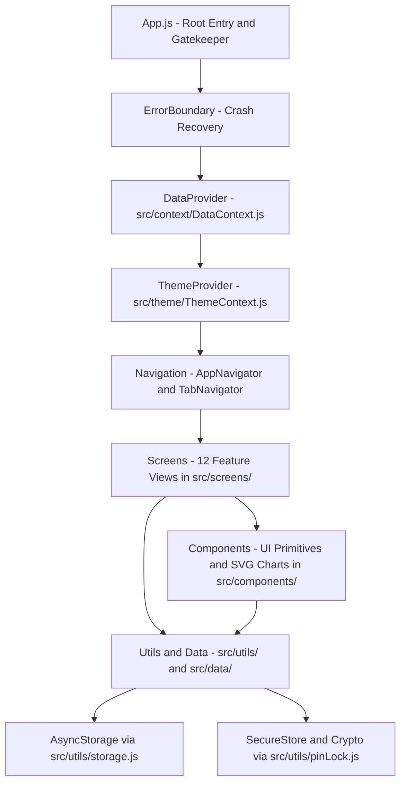

# MindNest Architecture 📐

This document explains how MindNest is structured under the hood. Every diagram below reflects the actual files, hooks, routes, storage keys, and data models in the repository.

---

## 1. Layered Architecture

MindNest follows a clean top-down layered architecture where `App.js` preloads the Nunito font, wraps everything in `ErrorBoundary`, and connects `DataProvider` into `ThemeProvider`. Screens never talk directly to device storage APIs; instead, they read state and invoke actions exposed by `useData()` and access colors, typography, and spacing via `useTheme()`. Pure business logic (scoring, stats, insights, streak detection, and recommendations) lives in stateless functions under `src/utils/`, making the math easy to unit-test independently from the React Native UI. Hardware-facing helpers (`storage.js`, `haptics.js`, `notifications.js`, `pinLock.js`) wrap `AsyncStorage`, `expo-secure-store`, `expo-crypto`, `expo-haptics`, and `expo-notifications` behind safe `try/catch` boundaries.

---
