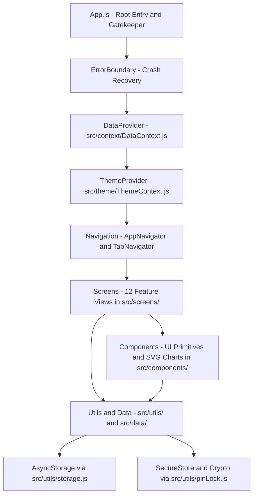
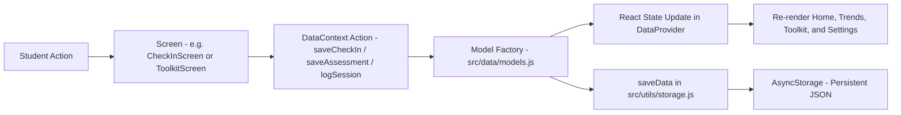
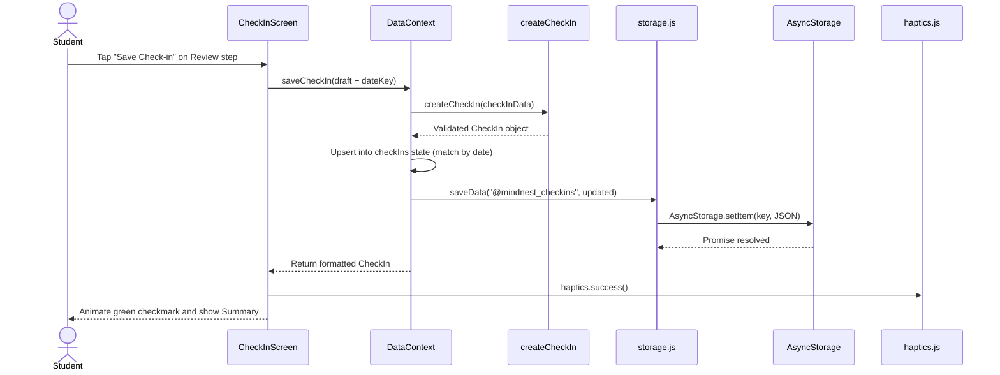
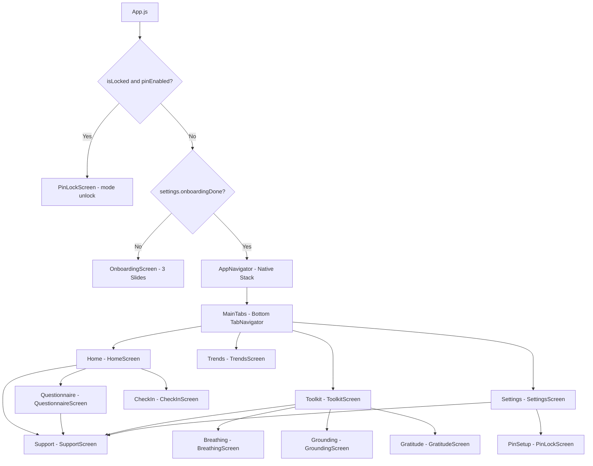
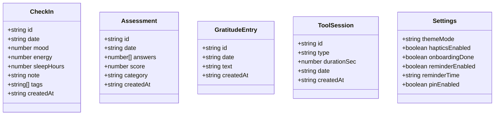

# MindNest Architecture 📐

This document explains how MindNest is structured under the hood. Every diagram below reflects the actual files, hooks, routes, storage keys, and data models in the repository.

---

## 1. Layered Architecture

MindNest follows a clean top-down layered architecture where `App.js` preloads the Nunito font, wraps everything in `ErrorBoundary`, and connects `DataProvider` into `ThemeProvider`. Screens never talk directly to device storage APIs; instead, they read state and invoke actions exposed by `useData()` and access colors, typography, and spacing via `useTheme()`. Pure business logic (scoring, stats, insights, streak detection, and recommendations) lives in stateless functions under `src/utils/`, making the math easy to unit-test independently from the React Native UI. Hardware-facing helpers (`storage.js`, `haptics.js`, `notifications.js`, `pinLock.js`) wrap `AsyncStorage`, `expo-secure-store`, `expo-crypto`, `expo-haptics`, and `expo-notifications` behind safe `try/catch` boundaries.

---
## 2. Unidirectional Data Flow

Whenever a student completes a check-in, weekly assessment, gratitude entry, or coping session, the screen passes the raw input to an action in `DataContext`. That action validates and formats the record using a factory function in `src/data/models.js`, updates React state immediately so the UI stays responsive, and writes the updated array as JSON into `AsyncStorage`. Because `HomeScreen`, `TrendsScreen`, and `ToolkitScreen` all subscribe to `useData()`, any change automatically updates Today's summary, charts, streaks, and weekly tool counts without manual refreshing. On startup, `DataContext` reverses this once by reading all five keys from `AsyncStorage` in parallel with `Promise.all` before rendering navigation.

---

## 3. Sequence Diagram: Saving a Daily Check-in

On the Review step of `CheckInScreen`, tapping **Save Check-in** calls `saveCheckIn()` with today's local `YYYY-MM-DD` date key from `toDateKey()`. Inside `DataContext`, `createCheckIn()` validates the numeric mood/energy bounds (`1–5`), ensures `sleepHours` is non-negative, trims the note, and attaches an ID and ISO timestamp. `saveCheckIn` then performs an upsert by date—updating today's entry in place if the student is editing, or prepending a new entry—before persisting the array under `@mindnest_checkins`. Finally, `CheckInScreen` triggers `haptics.success()` and plays a spring checkmark animation while `HomeScreen` and `TrendsScreen` reflect the saved entry automatically.

---
## 4. Navigation Map

Navigation begins in `App.js`, which enforces two full-screen startup gates before mounting `AppNavigator`: the PIN lock screen (when `pinEnabled` is true and a hash exists in `SecureStore`, plus after 30+ seconds in the background) and the 3-slide `OnboardingScreen` (until `onboardingDone` becomes true). Once inside `AppNavigator`, the student lands on `MainTabs`, which holds the 4 primary tabs: `Home`, `Trends`, `Toolkit`, and `Settings`. Full-screen flows (`CheckIn`, `Questionnaire`, `Breathing`, `Grounding`, `Gratitude`, `Support`, and `PinSetup`) are pushed onto the root native stack above the tab bar so exercises stay distraction-free with a clear back or close action.

---

## 5. Data Models and Local Storage Keys

All five models are created and sanitized by factory functions in `src/data/models.js` (`createCheckIn`, `createAssessment`, `createGratitudeEntry`, `createToolSession`, and `DEFAULT_SETTINGS`) and stored as JSON arrays or objects under `STORAGE_KEYS` (`@mindnest_checkins`, `@mindnest_assessments`, `@mindnest_gratitude`, `@mindnest_sessions`, and `@mindnest_settings`). Calendar dates use local-time `YYYY-MM-DD` strings from `toDateKey()` in `src/utils/dateUtils.js` so UTC timezone shifts never split a student's late-night check-in onto the wrong day. Two additional lightweight keys sit alongside them: `@mindnest_support_dismissed_date` in `AsyncStorage` (to remember if the Home `SupportCard` was hidden today) and `mindnest_pin_hash` in `expo-secure-store` (holding only the salted SHA-256 PIN digest).
